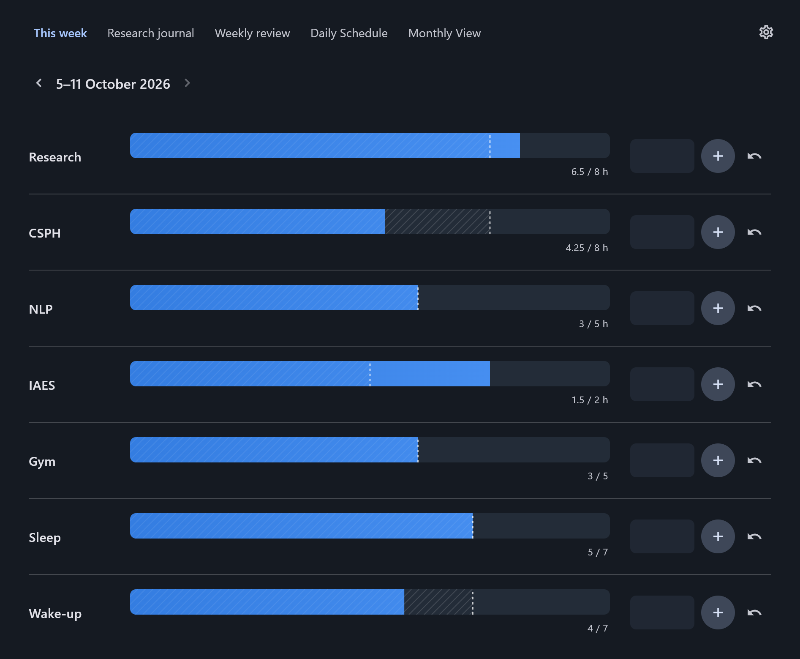

# TrackStudy

A local-first weekly tracking app for Windows and Android. Record study hours and habits, keep research notes, and plan your week. No account or internet connection is required; optional Supabase synchronization keeps your devices in sync.



## Features

- Weekly category goals with minimums, targets, progress bars, and an auditable entry history.
- Research Journal with Learned, Question, Next, and saved answers.
- Weekly Review with scores derived from tracking and automatically saved drafts.
- Recurring weekday schedules with descriptions, plus a monthly academic calendar.
- Dark/light themes and device-local tab visibility and drag reordering.
- Optional Windows tray mode, start at sign-in, and background synchronization.

Type an amount and press **Enter** or **+**. Inputs start empty and clear after a successful addition. **Undo** reverses the latest active entry; click the total beneath a bar to inspect entries. Weeks start on local calendar Mondays, and historical weeks remain available.

In **Settings → Tabs on this device**, drag a handle to reorder tabs; hold the handle first on Android. This Week stays first, and hidden tabs retain their position. These preferences are not synchronized.

## Windows

For development, install Flutter **3.47.5** / Dart **3.13.4**, Git, and Visual Studio 2022 or Build Tools with **Desktop development with C++**, Windows SDK, and CMake. Enable Windows Developer Mode for plugin symlinks.

Run these PowerShell commands from the project root:

```powershell
./tool/flutter.ps1 pub get
./tool/flutter.ps1 run -d windows
./tool/package.ps1
```

The wrapper uses Flutter on PATH, or an optional local SDK in `.tools/flutter`. Packaging creates `dist/TrackStudy-windows-x64.zip`. Extract the **whole ZIP** into a permanent folder, then run `trackstudy.exe` or double-click **Create Desktop Shortcut.bat**. The installer creates or updates a normal Desktop shortcut, supports redirected Desktops and spaces in paths, and needs no administrator access.

Normal launch and tray **Open TrackStudy** maximize the window. In Settings, **Run in background** makes Close hide to the tray; use **Quit** to exit. **Start with Windows** starts quietly in the tray when background mode is also enabled. Quit the running app before replacing its extracted files, and rerun the shortcut creator if you move its folder.

For environments with extracted MSVC/SDK tools, `tool/build-portable.ps1` provides an optional local-toolchain build. The standard Visual Studio build remains supported; toolchains are not included in the app package.

## Android

Install an Android SDK and compatible JDK, then build with:

```powershell
./tool/package-android.ps1
```

Install `dist/TrackStudy-android-release.apk` on Android 7.0 or newer. Future updates must use the same package ID and signing key; install over the existing app without uninstalling. See [Android setup and signing](docs/ANDROID.md).

## Optional synchronization

Follow [Supabase setup](docs/SUPABASE.md), apply the SQL migrations in order, and copy `.env.example` to the ignored `.env.local` with your project's HTTPS URL and publishable client key. The run/package helpers include those public client values in the build. Without configuration, TrackStudy works locally.

Sign in under **Settings → Sync**. Records save locally first, synchronize when connected, and retry after failures. Sign-out retains local data. Android may suspend background work; reopen the app to resume synchronization.

## Data and backups

**Settings → Data** shows the database location and provides JSON export/restore. The database lives separately from the executable, so replacing the app does not replace your data. Restore validates the backup before changing data and creates a safety copy. Local databases and JSON exports are not encrypted; keep them private.

Changing category defaults affects the current and future weeks; historical goals remain intact. Do not copy a live SQLite file on its own: use Export JSON or close the app first.

## Development checks

Run Flutter commands sequentially in one checkout:

```powershell
./tool/flutter.ps1 analyze
./tool/flutter.ps1 test
./tool/test-windows.ps1
./tool/test-windows.ps1 -SkipBuild -Autostart
npm install --prefix .tools/sql-test --no-audit --no-fund @electric-sql/pglite@0.5.8
node tool/test-supabase.mjs
```

Windows native tests use isolated data and test startup settings. The SQL harness runs migrations and ownership/RLS checks locally without contacting a live Supabase project. Android native test instructions are in the [Android guide](docs/ANDROID.md). GitHub Actions runs the Windows checks and packages a portable ZIP.

Application code is in `lib/`; platform runners are in `windows/` and `android/`, database policies in `supabase/migrations/`, and tests in `test/` and `integration_test/`.

Licensed under the [MIT License](LICENSE). The screenshot uses fictional demo data.
