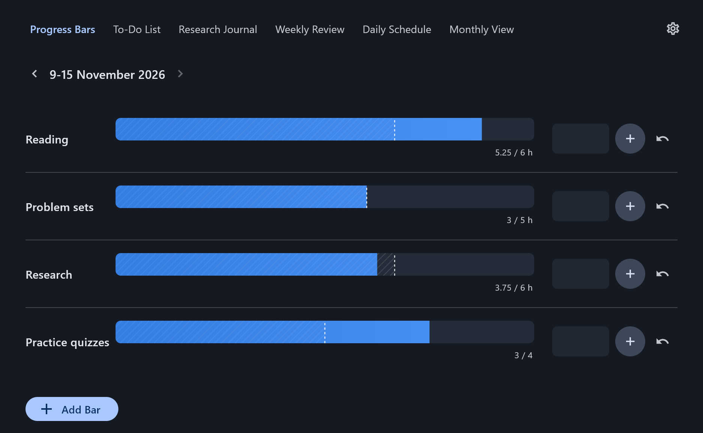
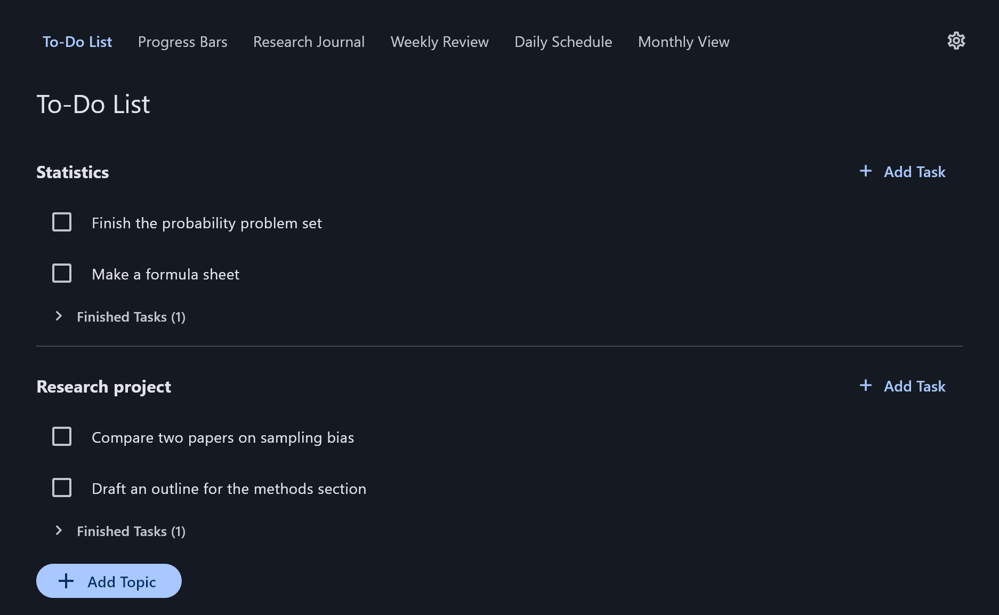
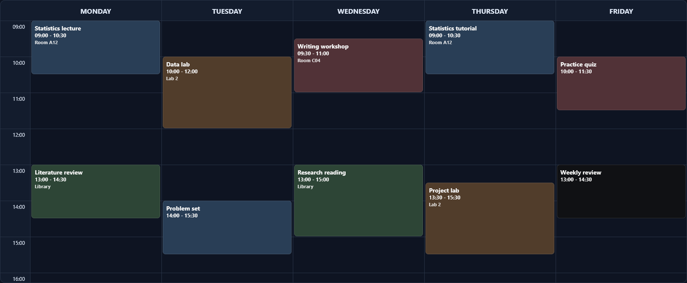

# TrackStudy

TrackStudy is a study and research planner for Windows and Android. Plan your week, track progress against your goals and keep notes on what you learn. It works offline without an account, with optional sync between devices.



## What you can do

- **See how the week is going.** Set a minimum and a target in Progress Bars, log time or counts and check earlier weeks. Weekly Review shows your totals alongside notes that save as you type.
- **Keep track of what to do next.** Group assignments and research tasks by topic, drag them into order and check them off. In Research Journal, record what you learned, save questions and add answers as you find them.
- **Make time for the work.** Use Daily Schedule for recurring classes and study blocks. Use Monthly View for exams, deadlines and other dated events. Both views offer five colours.



## Share your timetable

Open **Daily Schedule** and use **Export** to save a PNG of the days and hours you choose. The image uses the app's current light or dark theme on Windows and Android.



[See the same timetable in light mode](docs/screenshots/schedule-export-light.png)

All images use fictional study data.

## Under the hood

- **Local storage.** SQLite stores each week's goal settings and individual progress entries. Changes to a goal leave earlier weeks intact. JSON restore validates the backup in a temporary database, and the app keeps a safety copy. [Storage code](lib/data/local_repository.dart) · [Data and backups](docs/DATA.md)
- **Optional sync.** Pending edits survive app restarts and retry when a connection is available. Per-record causal histories distinguish later edits from concurrent ones. The merge picks a deterministic winner and saves conflict copies for recovery. Supabase row-level security limits cloud access to the signed-in user's records. [Sync code](lib/sync) · [Database policies](supabase/migrations)
- **Schedule rendering.** The Flutter schedule and PNG renderer use the same rules to lay out overlapping blocks. Windows uses a Save dialog. On Android 10 and later, the app saves to Downloads. Older Android versions use the system document picker. [Schedule layout](lib/presentation/schedule_layout.dart) · [File saving](lib/platform/schedule_png_file.dart)

GitHub Actions runs the Flutter unit and widget tests, Windows integration tests and local PostgreSQL checks for migrations, ownership and row-level security. The Android integration tests cover native storage and sync against a simulated cloud. [Windows workflow](.github/workflows/windows.yml) · [Integration tests](integration_test)

## Get started

The source is at version **1.8.1+13**. The project uses Flutter **3.47.5**.

**Try the Windows build.** Open a successful Windows workflow run and sign in to download the `TrackStudy-windows-x64` artifact if it is still available. Extract the entire portable ZIP and run `trackstudy.exe`. The Releases page is currently empty. [GitHub Actions](https://github.com/ricardo55ribeiro/TrackStudy/actions) · [Windows setup](docs/WINDOWS.md)

**Run from source on Windows.** Install the Windows build tools, then run these commands in PowerShell from the repository root. [Windows prerequisites](docs/WINDOWS.md#build-from-source)

```powershell
./tool/flutter.ps1 pub get
./tool/flutter.ps1 run -d windows
```

- **Build for Windows.** Run `./tool/package.ps1` to produce `dist/TrackStudy-windows-x64.zip`.
- **Build for Android.** Run `./tool/package-android.ps1` on Windows to build a signed APK for Android 7.0 or later. [Android setup and signing](docs/ANDROID.md)
- **Sync between devices.** Configure your own Supabase project, apply the migrations and sign in with the same account on both devices. [Supabase setup](docs/SUPABASE.md)

## License

[MIT License](LICENSE)
